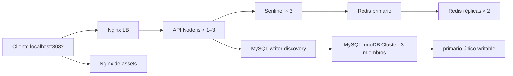

# Arquitectura

`lb` publica solo `127.0.0.1:8082`; assets publica `127.0.0.1:8081`. No se publican MySQL, Redis ni Sentinel. La red `frontend` recibe tráfico local; `backend`, `redis-internal` y `db-internal` son bridges internos del proyecto. Los volúmenes con datos son Docker named volumes.

## Redis

Un Redis primario y dos réplicas asíncronas con AOF (`appendfsync everysec`) y una identidad de volumen distinta por nodo. Tres procesos Sentinel comparten `quorum=2`; al perder el primario, promueven una réplica y reconfiguran las restantes. IORedis descubre el primario por nombre `ha-cache` y reintenta conexiones. Hay una ventana de detección de 5 s configurada más tiempo de elección/reconexión. El endpoint `PUT /api/cache` usa `WAIT 2 1500` y solo devuelve éxito si las dos réplicas reconocen la escritura. Esto reduce el riesgo de perder un valor reconocido, pero no sustituye una confirmación durable síncrona ni promete RPO cero; si una réplica no confirma dentro del límite, la API devuelve 503.

## MySQL

MySQL 8.4 InnoDB Cluster, Group Replication en modo single-primary y tres votantes. La API recibe tres nombres DNS estables de servicio Docker y prueba `@@global.read_only` para localizar al primario writable; guarda un pool para ese nodo y reescanea cada dos segundos o tras un error de conexión. El descubrimiento no decide elecciones: el clúster con mayoría 2/3 lo hace. Si se pierde quórum, la API no escribe en secundarios. La implementación reduce dependencias externas pero el descubrimiento vive en el proceso API, por lo que cada réplica mantiene su propio pool/cache. Group Replication no promete cero pérdida de transacciones recibidas pero aún no replicadas de forma certificada; la aplicación debe tolerar transacciones ambiguas y usar IDs idempotentes.

`db-setup` configura las instancias en primer inicio. Evite editar manualmente la topología mientras este iniciador se ejecuta. En recuperación posterior revise el nodo writable que reporta `/api/status` y `performance_schema.replication_group_members` antes de generar carga.

## Límites y persistencia

Compose aplica `cpus`, `mem_limit`, `mem_reservation` (soft limit/high según el engine) y `pids_limit`. Los límites efectivos se comprueban en `/sys/fs/cgroup` dentro del contenedor. `oom_score_adj` es una preferencia del kernel, no una inmunidad frente a OOM. El host subyacente es Linux en Docker Desktop/WSL2; montajes de Windows pueden mostrar distinto rendimiento y semántica de caché que un disco Linux nativo. API, configuración y assets están en la capa/Bind mount; datos MySQL y Redis están en volúmenes nombrados.

La réplica de lectura/escritura de API está en 1 instancia por defecto y se escala explícitamente a 2 o 3. Nginx 1.27 usa DNS del bridge Docker, re-resuelve `api`, y tiene reintentos pasivos `max_fails`/`fail_timeout`; OSS Nginx no realiza health checks activos por upstream.
